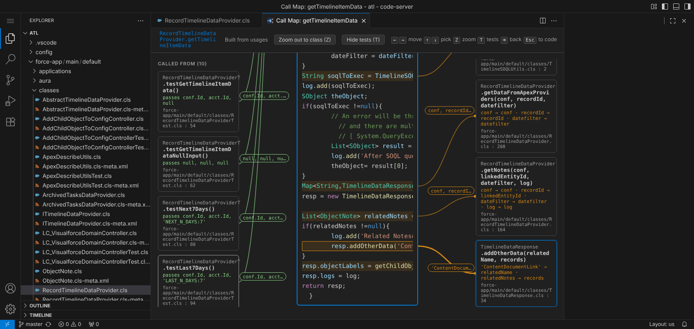
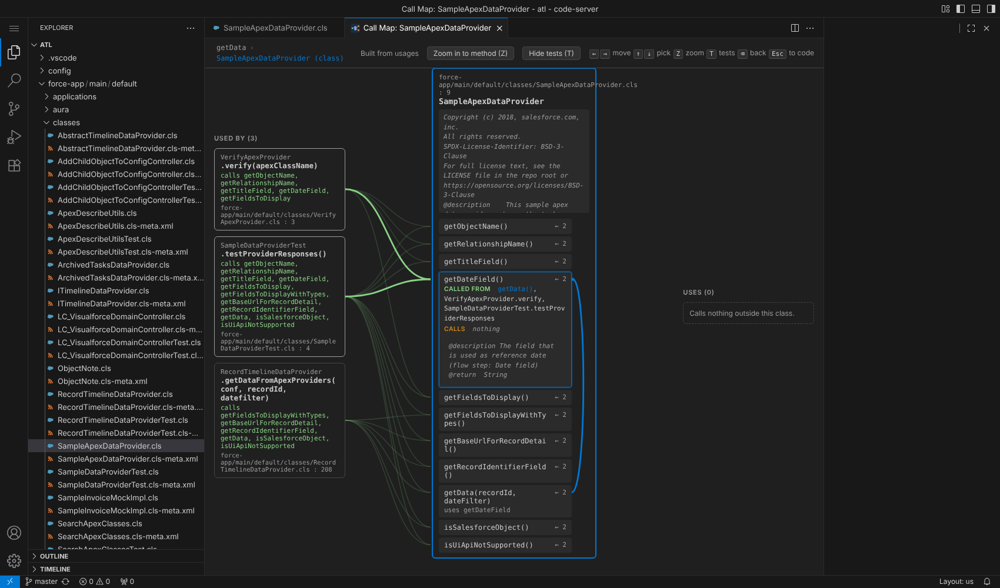
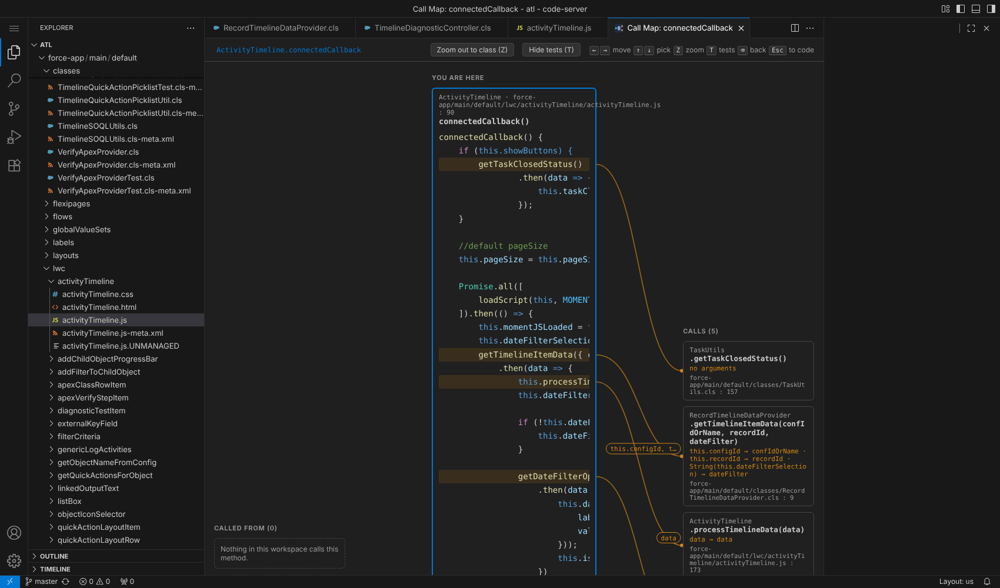

# Call Map

Zoom out from the method you're reading into a graph of where it sits in the code.



- **Called from** (left): every method that calls this one, with the arguments it passes.
- **You are here** (middle): the method, its comment and its code, with each call line highlighted.
- **Calls** (right): every method it calls. Lines start at the exact call, are labeled with the arguments, and each box shows which argument lands in which parameter (`total → amount`).

Walk the calls with the arrow keys. When you highlight a method, its doc comment opens in the box so you can read it before you go there. Files don't get in the way: each box names its file, and you never have to open them while you follow the logic.

## Use it

1. Put the cursor inside a method.
2. Press **Ctrl+Alt+G** (**Cmd+Alt+G** on Mac), or right-click and pick **Zoom Out to Call Map**.

If the cursor isn't in a method (a field, the class header, a comment), or focus is outside the editor, the map opens on the class of the file on screen instead. To map a file without opening it, right-click it in the Explorer and pick **Open with Call Map** (shown when a single file is selected).

| Key | What it does |
| --- | --- |
| Z | Zoom out to the whole class, or back in to a method. |
| → | Highlight what this method calls. Press again (or Enter) to go there. |
| ← | Highlight who calls this method. Press again (or Enter) to go there. |
| ↑ ↓ | Pick another box in that column. |
| T | Hide or show test methods. |
| Backspace | Step back along the path you followed. |
| Esc | Close the map and jump to the method you ended on. |

Clicking a box selects it, clicking it again goes there, and the path at the top lets you jump back to any step.

In long methods the map follows you: picking a call scrolls the code to the line that makes it, and the *Called from* and *Calls* columns stay beside the code as it scrolls (they scroll on their own when they're longer than the window). In the class view, picking a box scrolls to the method rows it's linked to.

### Zoom out to the class

Press **Z** (or the **Zoom out to class** button) to see the whole class: its methods in the middle, the methods outside the class that use it on the left, and what it uses on the right. ↑ ↓ pick a method and light up its lines. The picked method lists what it's called from and what it calls, both inside the class (in the accent color) and outside it, and blue arcs on the right connect methods that call each other. Enter or Z zooms back in to that method. Moving left or right travels to the other class and stays at class level.



### Hide tests

Press **T** (or **Hide tests**) to leave test methods out of the map, so you see only the logic. A test method is one marked `@isTest`, `@IsTest`, `testMethod` or `@Test`, any method in an `@isTest` class, and anything in a `*.test.ts`/`*.spec.ts` file, a `__tests__` folder or `src/test`. The choice is remembered (setting `callMap.hideTests`).

### Your editor's colors

Code in the map is colored with your current color theme and the same grammars the editor uses, including your `editor.tokenColorCustomizations`. It follows theme changes. Semantic highlighting (an extra layer some languages add on top, such as TypeScript's) isn't reproduced, so a few names can differ slightly.

### In the editor: hover and jump

- **Hover** a method name (where it's declared or called) to see *Called from* and *Calls*; hover a class name to see *Used by* and *Uses*. Every name is a link. Use VS Code's **Go Back** (Alt+← on Windows, Ctrl+Alt+- on Linux, Ctrl+- on Mac) to return. Turn it off with `callMap.hover.enabled`.
- **Ctrl+Alt+H** opens a quick list of callers and calls for the method at the cursor (or the method a call goes to). Type to filter, Enter to go there.

Ctrl+Click stays VS Code's *Go to Definition* and Alt+Click stays multi-cursor; Ctrl+Alt+G and Ctrl+Alt+H aren't used by VS Code in the editor.

## Languages

- **TypeScript, JavaScript, Java** (with Red Hat's Java extension) and any other language whose extension supports *call hierarchy*: works directly.
- **Apex**: the Salesforce Apex language server doesn't provide call hierarchy, so Call Map builds the graph from *find all references* and *go to definition* when the Salesforce Extension Pack answers them. When it doesn't (no extension, still indexing, or the folder isn't an SFDX project), Call Map matches calls by name instead: `ClassName.method(...)` goes to `ClassName.cls`, and an unqualified `method(...)` to the same class. The same name matching works for Java files.
- **Salesforce frontend ↔ Apex**: LWC files that `import x from '@salesforce/apex/Class.method'` are linked to that Apex method, whether they call it (`x({ recordId: this.recordId })`) or use it in `@wire(x, { … })`. Object keys are matched to the Apex parameters, so the lines read `this.recordId → recordId`. Aura `component.get("c.method")` is linked through the bundle's `controller="Class"`. Open the map on an Apex method to see the components that call it on the left, or on an LWC method to see the Apex it calls on the right.

  

- **LWC templates ↔ JS**: an element with an event handler (`<lightning-button onclick={handleSave}>`) calls that method in the component's JS, so a map can follow a button through its handler into Apex. Each element with handlers shows as its own box; the template's class view lists them all.
- To force the second approach for a language, add its id to the `callMap.useUsagesFor` setting.

## Speed

When no language server answers (Apex without the Salesforce extension), Call Map keeps an index of every Apex, Java and Lightning file: the calls in it, its method declarations and what its classes extend. It's built in the background when VS Code starts and updated one file at a time as you type, save, pull or delete files, so finding callers doesn't read the whole workspace again. On a test workspace of 3,000 Apex classes, the first map opens in about 3 seconds and later ones in well under a second.

## Install

Call Map is installed from a `.vsix` file. Get the latest one from the [Releases page](https://github.com/MicoGujic/Call-Map/releases), or from the *call-map-vsix* artifact of any run on the [Actions tab](https://github.com/MicoGujic/Call-Map/actions).

- **In VS Code:** open the Extensions view, click the `…` menu at the top, choose **Install from VSIX…**, and pick the file.
- **From a terminal:** `code --install-extension call-map-<version>.vsix`

To share it, send the same file.

## Develop

```sh
git clone https://github.com/MicoGujic/Call-Map.git
cd Call-Map
npm ci
npm run compile
```

- Press **F5** in VS Code to start an Extension Development Host on `test-fixtures/shop` with Call Map loaded.
- `npm run watch` recompiles as you edit.
- `npm run test:unit` runs the parser tests.
- `npm run package` builds `call-map-<version>.vsix` in the project folder.
- `npm run test:integration` opens VS Code on `test-fixtures/shop` and checks the TypeScript graph, the Apex fallback path and the command. These tests haven't been run yet and may need updating.

Every push and pull request runs the **Build** workflow: compile, unit tests and packaging, with the `.vsix` attached to the run.

## Release a version

1. Bump `version` in `package.json` and add a section to `CHANGELOG.md`.
2. Commit, then tag and push: `git tag v0.6.2 && git push origin main v0.6.2`.
3. The Build workflow checks that the tag matches `package.json` and publishes a GitHub release with the `.vsix` attached.
