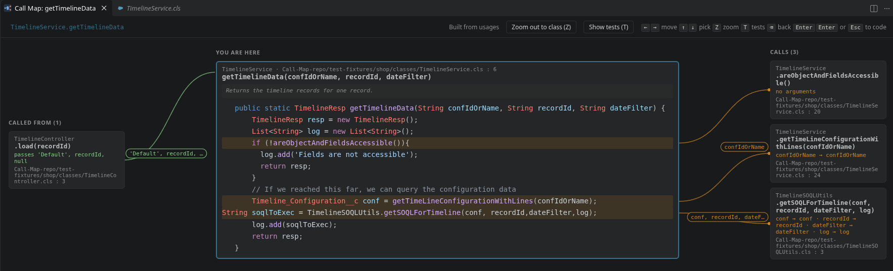
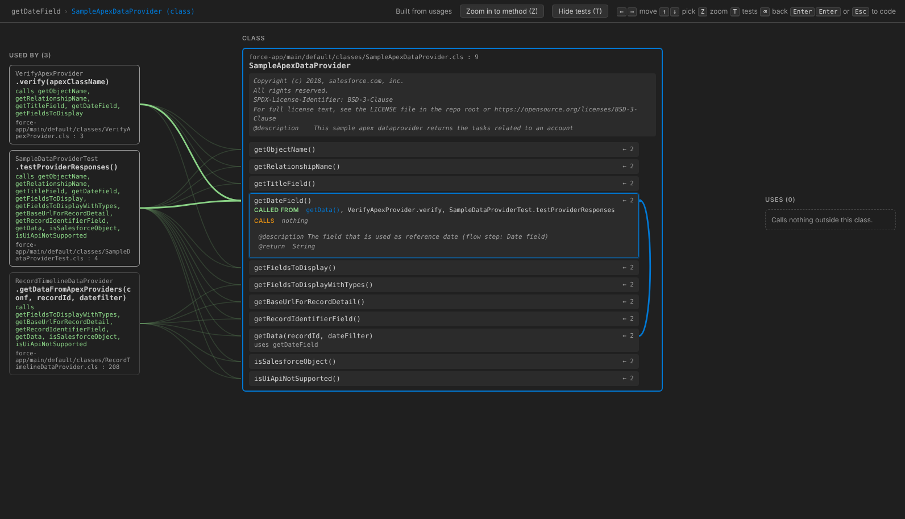
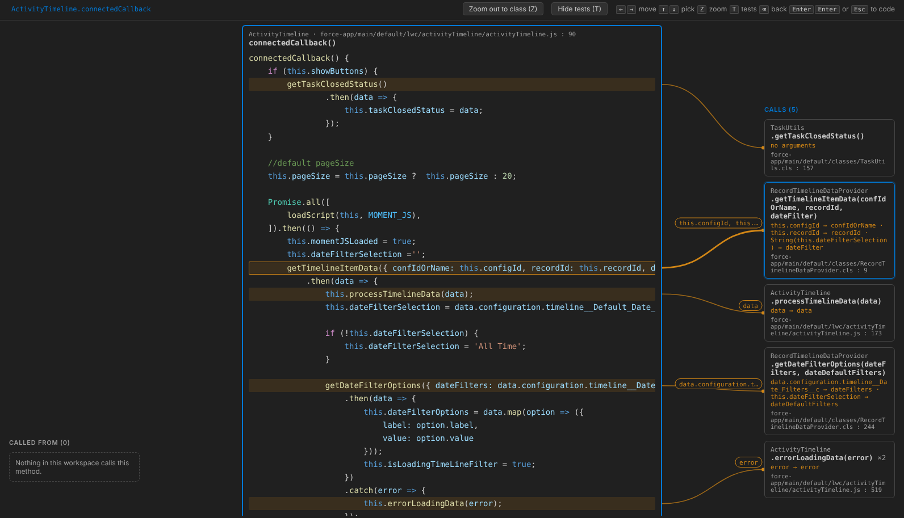

# Call Map

Zoom out from the method you're reading into a map of where it sits in the code: who calls it on the left, what it calls on the right, and the arguments on every line. Walk the map with the arrow keys and jump back to the code when you're done. Built for Salesforce (Apex, LWC, Aura), and it also works for TypeScript, JavaScript and Java.

- **Called from** (left): every method that calls this one, with the arguments it passes.
- **You are here** (middle): the method, its comment and its code, with each call line highlighted.
- **Calls** (right): every method it calls. Lines start at the exact call, are labeled with the arguments, and each box shows which argument lands in which parameter (`total → amount`).

When you highlight a method, its doc comment opens in the box so you can read it before you go there. Each box names its file, so you can follow the logic without opening files.

## Install

- **From the Marketplace:** search for **Call Map** in the Extensions view, or install [MicoGujic.salesforce-call-map](https://marketplace.visualstudio.com/items?itemName=MicoGujic.salesforce-call-map).
- **From a file:** download the `.vsix` from the [Releases page](https://github.com/MicoGujic/Call-Map/releases). In the Extensions view, open the `…` menu, choose **Install from VSIX…** and pick the file, or run `code --install-extension salesforce-call-map-<version>.vsix`.

## Use it

1. Put the cursor inside a method.
2. Press **Ctrl+Alt+G** (**Cmd+Alt+G** on Mac), or right-click and pick **Zoom Out to Call Map**.

If the cursor isn't in a method (a field, the class header, a comment), the map opens on the class of the file instead. To map a file without opening it, right-click it in the Explorer and pick **Open with Call Map** (shown when a single file is selected).

| Key | What it does |
| --- | --- |
| → | Highlight what this method calls. Press again (or Enter) to go there. |
| ← | Highlight who calls this method. Press again (or Enter) to go there. |
| ↑ ↓ | Pick another box in that column. |
| Z | Zoom out to the whole class, or back in to a method. |
| T | Hide or show test methods. |
| Backspace | Step back along the path you followed. |
| Enter, Enter | On the method in the middle: open it in the editor. The first Enter asks, the second opens it. |
| Esc | Close the map and open the method you ended on in the editor. |

With the mouse, clicking a box selects it and clicking it again goes there. Double-clicking the method in the middle opens it in the editor. The path at the top lets you jump back to any step.

In long methods the map follows you. Picking a call scrolls the code to the line that makes it, and the side columns stay next to the code as it scrolls.

### Zoom out to the class

Press **Z** to see the whole class: its methods in the middle, the code outside the class that uses it on the left, and what it uses on the right.

- ↑ ↓ pick a method and light up its lines.
- The picked method lists what it's called from and what it calls, inside the class (in the accent color) and outside it.
- Arcs on the right connect methods that call each other.
- Enter or Z zooms back in to that method. Moving left or right goes to the other class and stays at class level.

### Hide tests

Press **T** to leave test methods out of the map, so you see only the logic. The choice is remembered (setting `callMap.hideTests`). A test method is:

- one marked `@isTest`, `@IsTest`, `testMethod` or `@Test`;
- any method in an `@isTest` class;
- anything in a `*.test.ts` or `*.spec.ts` file, a `__tests__` folder or `src/test`.

### Hover and jump in the editor

- **Hover** a method name, where it's declared or called, to see *Called from* and *Calls*. Hover a class name to see *Used by* and *Uses*. Every name is a link, and VS Code's **Go Back** returns you. Turn it off with `callMap.hover.enabled`.
- **Ctrl+Alt+H** opens a quick list of callers and calls for the method at the cursor. Type to filter, Enter to go there.

Ctrl+Alt+G and Ctrl+Alt+H aren't used by VS Code in the editor. Ctrl+Click and Alt+Click keep their usual meaning.

### Your editor's colors

Code in the map uses your color theme and the editor's own grammars, including `editor.tokenColorCustomizations`, and follows theme changes. Semantic highlighting (an extra coloring layer some languages add, such as TypeScript) isn't reproduced, so a few names can look slightly different.

## Languages

- **Apex.** The Salesforce Apex language server doesn't offer call hierarchy, so Call Map uses *find all references* and *go to definition* when the Salesforce Extension Pack answers them. When it doesn't (no extension, still indexing, or not an SFDX project), Call Map matches calls by name:
  - `ClassName.method(...)` goes to `ClassName.cls`;
  - `variable.method(...)` goes to the variable's declared type and the classes that extend it;
  - a plain `method(...)` goes to the same class.
- **LWC and Aura to Apex.** These calls are linked to the Apex method:
  - LWC `import x from '@salesforce/apex/Class.method'`, whether called (`x({ recordId: this.recordId })`) or used in `@wire`;
  - Aura `component.get("c.method")`, through the bundle's `controller="Class"`.

  Object keys are matched to the Apex parameters, so lines read `this.recordId → recordId`.

  

- **LWC templates to JavaScript.** An element with an event handler (`<lightning-button onclick={handleSave}>`) calls that method in the component's JavaScript. That lets a map follow a button through its handler into Apex.
- **TypeScript, JavaScript, Java** (with Red Hat's Java extension), and any language whose extension supports *call hierarchy*, work directly. Java also gets the name matching above when no language server answers.

## When it runs

Call Map starts on its own in Salesforce projects, meaning a folder with an `sfdx-project.json` file. In any other folder, it starts the first time you use one of its commands (Ctrl+Alt+G, Ctrl+Alt+H or **Open with Call Map**). Hovers work from then on.

Once started, it builds an index of the Apex, Java and Lightning files in the folder in the background. The index records the calls in each file, its method declarations and what its classes extend. It's updated one file at a time as you type, save, pull or delete files.

On a test workspace of 3,000 Apex classes, the first map opens in about 3 seconds and later ones in well under a second.

## Privacy and security

- **No network access.** Call Map doesn't send anything anywhere: it has no telemetry, no update checks and no network code. VS Code itself handles updates from the Marketplace.
- **What it reads:**
  - in the open folder: `.cls`, `.trigger` and `.java` files, and the `.js` and `.html` files of LWC and Aura components, skipping `node_modules`, `.sfdx`, `.git`, `target`, `build` and `out`;
  - the files of your active color theme and the grammar files of installed extensions, to color code the way your editor does.
- **What it keeps:** its index lives in memory only. It doesn't store files, caches or logs on disk.
- **What it writes:** only the `callMap.hideTests` setting, when you press T.
- **Other extensions:** to find callers and calls, Call Map asks the language extensions you have installed, through VS Code's standard commands, and those extensions answer on your machine. When a map includes LWC or Aura JavaScript, VS Code's built-in TypeScript support reads those files. Its *Automatic Type Acquisition* can download type definitions from the npm registry. To turn that off, set `"typescript.disableAutomaticTypeAcquisition": true`.
- **Untrusted folders:** Call Map stays off in folders VS Code hasn't trusted (Restricted Mode).
- **The map window** can't load anything from the internet, and runs only Call Map's own script. Names, comments and code from your files are shown as text.

To report a security problem, see [SECURITY.md](SECURITY.md).

## Settings

| Setting | Default | What it does |
| --- | --- | --- |
| `callMap.hideTests` | `false` | Leave test methods out of the map. T toggles it. |
| `callMap.hover.enabled` | `true` | Show callers and calls when hovering a method or class name. |
| `callMap.useUsagesFor` | `[]` | Language ids (such as `java`) that should use *find all references* and *go to definition* instead of call hierarchy. Apex does this on its own. |

## Contributing

See [CONTRIBUTING.md](CONTRIBUTING.md) for building, testing and releasing.

## License

[MIT](LICENSE)
